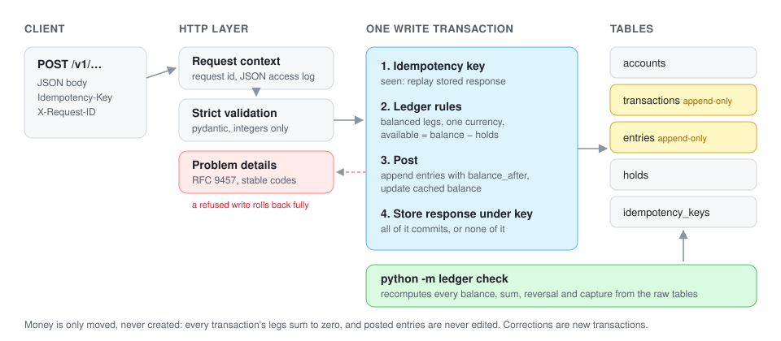

# ledger-service

[](https://github.com/ik-786/ledger-service/actions/workflows/ci.yml)
  

A double-entry ledger as an HTTP service: accounts, transfers, multi-leg journal entries, card-style
holds (authorize, then capture or void), reversals and idempotent writes. It is the part of a wallet
or payments backend that has to be right. Money is never created or lost, an account is never
overdrawn, and a retried request never moves money twice, including when many clients write at once.

Python, [Starlette](https://www.starlette.io/), [pydantic](https://docs.pydantic.dev/) and SQLite.
Three runtime dependencies.



## Design decisions

**Integer minor units.** Amounts are integers in the currency's smallest unit (cents, yen, fils).
No floats anywhere. JSON `10.0`, `"10"` and `true` are refused rather than coerced.

**Double entry.** Every transaction is a set of legs that sum to zero, and all legs share one
currency. A transfer is a two-leg transaction, a card payment with a fee can be three. New money
enters from an account created with `allow_negative: true` (a funding or settlement account), whose
balance goes negative by exactly the amount it has paid out. Summed over all accounts, the books are
always zero.

**Append-only history.** Posted entries and transactions are never updated or deleted. SQLite
triggers refuse it even outside the service. A mistake is corrected with a reversal, a new
transaction that mirrors the original, so the history shows both.

**Cached balances, checked independently.** Each account keeps a running balance so reads are one
row, and each entry stores `balance_after`, which makes statements cheap. Because a cache can drift,
`python -m ledger check` recomputes everything from the raw entries: every transaction balances, every
cached balance and `balance_after` matches, no normal account was ever below zero at any point in its
history, every reversal mirrors its original and every capture matches its hold. The tests corrupt a
database in nine different ways and check that each one is reported.

**One writer at a time, taken up front.** A funds check followed by a debit is two statements.
If another request could debit the same account between them, two payments could each see enough
money and both go through. Every write starts with `BEGIN IMMEDIATE`, which takes SQLite's write lock
before anything is read, so the check and the debit cannot be split, even by another process using
the same file. Reads use WAL mode and never wait for writers. The concurrency tests run 40
simultaneous payments, through four separate connection pools standing in for four server processes,
at a wallet that can afford 20, and require exactly 20 to succeed. With a plain `BEGIN` they fail.

**Writers queue instead of polling.** The first load test showed a p99 of 936 ms and a worst case of
3 s. SQLite's busy handler makes a waiting writer sleep and retry, so under contention some requests
kept losing the race. Writers in the same process now queue on a lock before `BEGIN IMMEDIATE`, and
each waiter gets the next turn. Same test, same machine: p99 71 ms, worst case 127 ms, and 16% more
throughput. The median went up, from 8 ms to 51 ms, because a request no longer gets lucky and
skips the queue. For payments, a predictable 70 ms beats a fast median with multi-second outliers.

**Idempotency keys commit with the effect.** A write may carry an `Idempotency-Key` header. The stored
response is written in the same database transaction as the money movement, so the key exists if and
only if the effect does. A retry with the same key and the same request gets the original response
back, byte for byte, with `Idempotent-Replayed: true`. The same key with a different request gets
`422 idempotency_key_reused`. A refused request stores nothing, so the client can retry the same key
once the problem (say, insufficient funds) is fixed. Keys are kept for 24 hours.

**Holds without a background job.** A hold reserves funds: available = balance − active holds. It can
be captured in full or in part (the rest is released) or voided. Expiry is evaluated when the hold
or its account is read, so an expired hold releases its funds at exactly `expires_at` and no cron job
is needed.

**Errors a client can program against.** Errors are RFC 9457 problem documents with a stable `code`,
listed in [docs/errors.md](docs/errors.md). Checks run in a fixed order, so the same request against
the same state always fails the same way. Responses carry an `X-Request-ID` (the caller's, if
sent), which also appears in the JSON access log.

**Durable commits.** `PRAGMA synchronous = FULL`: a write the API acknowledged survives a power cut.

## Quick start

```bash
pip install -e ".[dev]"
python -m ledger serve --db ledger.db          # http://127.0.0.1:8000
```

Or with Docker (runs as a non-root user, data in a volume):

```bash
docker build -t ledger-service .
docker run --rm -p 8000:8000 -v ledger-data:/data ledger-service
```

A card payment, end to end:

```bash
API=http://127.0.0.1:8000
json() { curl -s -X POST "$API$1" -H 'Content-Type: application/json' "${@:3}" -d "$2"; }

json /v1/accounts '{"name": "bank settlement", "currency": "USD", "allow_negative": true}'   # -> acc_SET
json /v1/accounts '{"name": "customer wallet", "currency": "USD"}'                            # -> acc_CUS
json /v1/accounts '{"name": "coffee shop", "currency": "USD"}'                                # -> acc_SHOP

# Top up the wallet with $50.00. Safe to retry: the key makes it happen once.
json /v1/transfers '{"from_account_id": "acc_SET", "to_account_id": "acc_CUS", "amount": 5000}' \
  -H 'Idempotency-Key: topup-2026-11-21-001'

# Authorize $12.00 at the till, then capture the final $9.50. The other $2.50 is released.
json /v1/holds '{"account_id": "acc_CUS", "destination_account_id": "acc_SHOP", "amount": 1200}'
json /v1/holds/hold_ID/capture '{"amount": 950}'

curl -s $API/v1/accounts/acc_CUS
# {"id": "acc_CUS", ..., "balance": 4050, "held": 0, "available": 4050, ...}

# Refund it: a new transaction that mirrors the capture.
json /v1/transactions/txn_ID/reverse '{"description": "order cancelled"}'
```

## API

| method | path | does |
|---|---|---|
| `POST` | `/v1/accounts` | open an account: `name`, `currency`, `allow_negative` |
| `GET` | `/v1/accounts` | list accounts, paginated |
| `GET` | `/v1/accounts/{id}` | `balance`, `held`, `available` |
| `GET` | `/v1/accounts/{id}/entries` | statement, newest first, each entry with `balance_after` |
| `POST` | `/v1/transfers` | move `amount` from one account to another |
| `POST` | `/v1/transactions` | post 2 to 50 legs that sum to zero |
| `GET` | `/v1/transactions/{id}` | a transaction, its entries, and `reversed_by` |
| `POST` | `/v1/transactions/{id}/reverse` | post the mirror image (once per transaction) |
| `POST` | `/v1/holds` | reserve funds for a destination, expiring after `expires_in_seconds` |
| `GET` | `/v1/holds/{id}` | `active`, `captured`, `voided` or `expired` |
| `POST` | `/v1/holds/{id}/capture` | move all or part of the held amount |
| `POST` | `/v1/holds/{id}/void` | release the hold |
| `GET` | `/healthz` | liveness and database check |

Every `POST` accepts `Idempotency-Key`. Lists take `limit` (1 to 100) and the `cursor` from the
previous page. Cursors are keyset based, so entries written while a client pages do not shift or
repeat later pages. Timestamps are ISO 8601 UTC with milliseconds. Supported currencies: USD, EUR, GBP,
INR, JPY, KWD.

## Testing

```bash
pytest                                   # 103 tests, about 30 seconds
LEDGER_MODEL_SEEDS=500 pytest tests/test_model.py
python scripts/loadtest.py --clients 32 --seconds 20
```

| layer | what it shows |
|---|---|
| API tests | every endpoint, every error code, validation edge cases, expiry to the millisecond, pagination under concurrent writes |
| concurrency | 40 threads spending from one wallet at once on a real SQLite file: exactly the affordable 20 succeed. 12 threads racing transfers, holds, captures and voids: the audit is clean and no wallet goes below zero available. 16 HTTP clients against a real uvicorn server, with retries: every transfer applied exactly once |
| idempotency | replay is byte-identical, key order and whitespace in the body don't matter, 20 simultaneous requests with one key apply once, keys expire after 24 h |
| model-based | random sequences of valid and invalid operations, each checked against a small reference model written with plain dicts: status, error code and every account's balance, held and available after every step, then a clean audit |
| audit | a clean ledger passes; nine kinds of corruption (cached balance, entry amount, `balance_after`, overdraft hidden in history, currency, capture amount, hold status, missing capture, wrong reversal) are each reported; triggers block edits and deletes |

The model-based test runs 30 sequences of 120 steps by default and 300 in CI. A local run of 500
sequences (60,000 random operations, each followed by a full balance comparison) found no difference
between the service and the model.

Load test on a 2-core container: 32 clients for 20 seconds, eight wallets so that clients contend
for the same rows, and 10% of requests are retries of an earlier request with the same key.

```text
clients 32, wallets 8, 20.1 s
requests 12349, 615 per second
latency ms: p50 50.7, p95 62.8, p99 71.0, max 127.3
  200                              2246
  201                              8366
  201 replayed                     1175
  422 insufficient_funds           562
money in wallets: 800000 (expected 800000)
wallets with negative available funds: 0
audit: ledger is consistent
```

Throughput is bounded by the single writer and by `synchronous = FULL`, which waits for the disk on
every commit. That trade is deliberate for a ledger.

CI runs ruff, mypy in strict mode, the tests on Python 3.11 to 3.13, 300 model sequences, the load
test with an audit, and a Docker build with a curl smoke test.

## Limits

- **One node.** SQLite allows one writer, so throughput scales with a faster disk, not more servers.
  The service logic would carry over to PostgreSQL, where the same guarantee needs `SELECT ... FOR
  UPDATE` on the debited accounts (locked in a fixed order to avoid deadlocks) or serializable
  isolation with retries.
- **No authentication or tenancy.** Any caller can move any account's money. Put it behind a gateway
  that authenticates callers, and scope idempotency keys per caller.
- **No currency conversion.** A transaction must stay in one currency. FX would be two transactions
  through per-currency clearing accounts.
- **Hold expiry is computed, not stored.** An expired hold keeps `status = 'active'` in the table and
  is reported as `expired` by the API. Reports that read the table directly must compare
  `expires_at` themselves.
- **Server clock.** Expiry and key retention use the server's clock. A large clock jump would expire
  holds early or late.

## Layout

```text
ledger/
  api.py           routes, strict body parsing, idempotency, problem details, request ids
  service.py       ledger rules: posting, holds, reversals, pagination
  db.py            connections, BEGIN IMMEDIATE transactions, migrations
  check.py         the independent audit
  schemas.py       request models and limits
  migrations/      SQL schema, with CHECK constraints and append-only triggers
tests/             API, concurrency, idempotency, model-based and audit tests
scripts/           load test and the Docker smoke test
docs/errors.md     every error code
```

## License

MIT
